# System architecture

## 1. Goals and non-goals

**Goals**: automatic, consent-based workout tracking from existing CCTV; correct member attribution above all; durable operation through camera and internet failures; a cloud layer that holds workout facts and reports but never video or biometric templates.

**Non-goals (this release)**: exercise form/quality scoring (Phase 9), weight estimation, cardio metrics beyond occupancy, any processing of non-consenting people beyond anonymous occupancy.

## 2. Components and responsibilities

```mermaid
flowchart LR
  subgraph Edge["Edge server (GPU, Docker, gym LAN)"]
    CG[camera-gateway<br/>RTSP/ONVIF ingest, reconnect, health] --> DET[detection<br/>person boxes]
    DET --> TRK[tracking<br/>per-camera local ids]
    TRK --> GID[fusion.global_identity<br/>ReID + spatial/temporal gating<br/>refuse ambiguous merges]
    GID --> ZON[fusion.equipment_association<br/>zone dwell → usage]
    ZON --> POSE[pose → signal<br/>joint angles]
    POSE --> REP[reps.state_machine<br/>hysteresis + plausibility]
    REP --> DEDUP[fusion.rep_dedup<br/>cross-camera window]
    DEDUP --> SETS[reps.set_segmenter]
    IDS[identity-service<br/>encrypted face store, consent gate] --> GID
    SETS --> Q[(SQLite WAL<br/>event queue)]
    IDS --> Q
    CG --> Q
    Q --> SYNC[sync client<br/>HMAC-signed batches]
  end
  SYNC -->|HTTPS| EF[Edge Function<br/>ingest-events]
  EF --> RPC[ingest_events RPC<br/>idempotent, per-event savepoints]
  RPC --> PG[(PostgreSQL + RLS)]
  PG --> FIN[finalize_attendance_session<br/>build_workout_summary]
  FIN --> NJ[notification_jobs]
  NJ --> NW[notification-worker<br/>Web Push]
  PG --> ADMIN[admin-web]
  PG --> MEMBER[member-web]
  PG -. Realtime .-> MEMBER
```

| Capability (spec §3) | Where it lives |
| --- | --- |
| Camera stream management | `edge_ai/camera` (RtspReader, probe, ONVIF WS-Discovery), `cameras` table, admin UI |
| Identity & consent management | `edge_ai/identity` (encrypted store, matcher, consent gate, entrance identifier, enrollment CLI), `device-sync` function, `consent_records`, `biometric_enrollments`, member settings, admin consents + **check-in kiosk** (QR) |
| Multi-camera identity fusion | `edge_ai/fusion/global_identity.py` fed by `edge_ai/fusion/onnx_reid.py` embeddings |
| Equipment & zone mapping | `camera_zones`, `equipment`, `edge_ai/fusion/equipment_association.py`, admin zone editor + floor map |
| Exercise classification | v1: equipment default exercise with zone confidence; Phase 5 adds a temporal classifier behind the same `exercise.activity.started` event |
| Pose estimation | `edge_ai/pose/onnx_pose.py` (YOLO-pose style ONNX, bottom-up, matched to tracks) → `edge_ai/pose/angles.py` |
| Repetition counting | `edge_ai/reps/state_machine.py` driven by `exercise_catalog.rep_profile` (synced from the cloud) |
| Set segmentation | `edge_ai/reps/set_segmenter.py` |
| Session management | `attendance_sessions`, `ingest_events` (check-in/out), `finalize_attendance_session`, `abandon_stale_sessions` |
| Cloud event synchronization | `edge_ai/events` (queue, sync), `supabase/functions/ingest-events`, `ingest_events()` |
| Report generation | `build_workout_summary()` → `workout_reports`, shared links via `get_shared_report()` |
| Notification delivery | `notification_jobs` + `services/notification-worker` |
| Operational monitoring | `/healthz`, `/metrics`, Prometheus alerts, `device_health_logs`, `camera_status_logs`, admin devices page |
| Security & audit logging | RLS, `audit_logs` triggers, device HMAC, secret scan in CI |

### Why the engines are consolidated inside `edge-ai`

The spec lists `identity-service`, `tracking-fusion`, `equipment-engine`, `exercise-engine` as separate services. On the edge they share decoded frames, GPU memory and one wall clock; splitting them across processes would mean serialising frames over IPC for no isolation benefit. They are therefore separate **packages** with typed interfaces (`Detector`, `PoseEstimator`, `GlobalIdentityRegistry`, `ZoneAssociator`, `RepCounter`) inside one process, and can be split later without changing the event contract. `workout-engine` and `report-engine` are SQL functions so finalisation is transactional; `notification-worker` is its own process because it has different scaling and failure characteristics.

## 3. Data flow and timing

1. `RtspReader` threads decode continuously; `CameraWorker` samples the latest frame at `inference_fps` (default 10 Hz). Dropping frames is preferred over queueing — latency stays bounded.
2. Detection → `IouTracker` (two-pass association, ByteTrack-style) → confirmed local tracks.
3. Each confirmed track becomes a `LocalObservation`; the registry associates it to a `GlobalIdentity` (or creates a new one, flagged `ambiguous` when two candidates are too close).
4. Foot point ∈ equipment zone for `ZONE_ENTER_DWELL_SECONDS` → `equipment.usage.started` + `exercise.activity.started`.
5. Pose runs **only** for people inside equipment zones; the profile's signal (e.g. mean knee angle) feeds a `RepCounter` per observing camera. `RepDeduplicator` admits the first observation of each physical rep per (identity, equipment) within a 700 ms window.
6. `SetSegmenter` opens a set on the first rep, closes after 4 s idle, computes `rest_before_seconds`, and marks sets unverified when tracking confidence dipped or the set was force-closed.
7. Every event is validated against `events.v1` at build time and persisted with a monotonic sequence in SQLite **before** anything is sent. The sync loop drains batches of ≤500, signs them, and acks on 200; 401/5xx/network errors back off and keep everything.
8. The Edge Function verifies the HMAC against all active secrets for the device (rotation overlap), checks clock skew, then calls `ingest_events`, which claims each `event_id` (idempotency), applies it in a savepoint, and records rejections individually.
9. `identity.checkout` (or staff/member checkout, or the 6-hour abandon job) runs `finalize_attendance_session`: closes dangling facts, builds the summary JSON, inserts the report (unique per session), and enqueues one notification (deduped by key).

## 4. Edge hardware and network assumptions

| Item | Pilot assumption | Verified by |
| --- | --- | --- |
| Cameras | RTSP H.264/H.265, 1080p, 15–25 fps, TCP transport, fixed mount, ≥ 2.4 m height | Phase 0 probe (`edge-ai probe`) |
| GPU | 1× NVIDIA ≥ 8 GB VRAM for 4–8 streams at 10 Hz inference (dev node: RTX 5050 Laptop 8 GB) | Phase 2 benchmark |
| CPU/RAM/disk | 8 cores, 32 GB, NVMe ≥ 500 GB (queue + encrypted templates; no video) | — |
| Network | Camera VLAN isolated from internet; edge host dual-homed; HTTPS egress to Supabase only; NTP enforced | Deployment checklist |
| Time sync | chrony/NTP on edge; server rejects batches outside ±300 s | `INGEST_CLOCK_SKEW_SECONDS` |

## 5. Versioned contracts

- `events.v1` — `packages/api-contracts/src/events.ts` (Zod) ⇄ `services/edge-ai/edge_ai/contracts/events_v1.py` (Pydantic). Both validate the same fixtures in CI. Breaking changes create `events.v2` alongside; the ingest RPC dispatches on `schema_version`.
- `WorkoutReportSummary` v1 — `packages/shared-types`, produced by `build_workout_summary()`.
- Web inputs — `packages/api-contracts/src/api.ts`, validated in server actions **and** again by RLS/constraints.

## 6. Failure modes and behaviour

| Failure | Behaviour |
| --- | --- |
| Camera drops | Reader reconnects with backoff; `camera.status` events; tracks on that camera end; other cameras continue; uncertain segment recorded when no camera covers the person |
| Internet down | Queue grows on disk (alert at 5k/100k); nothing is lost; replay is idempotent |
| Edge crash | SQLite WAL preserves queue and sequence; in-flight workout state is lost → open sets are force-closed as unverified at checkout (never fabricated) |
| Clock skew | Server rejects batch (401 with server_time); edge backs off hard; alert |
| Ambiguous identity | New identity, `identity_ambiguous` uncertainty, reps attributed to no member rather than the wrong one |
| Device secret leak | Rotate via `issue_device_secret()`; old secret valid 24 h; audit log records rotation |
| DB connection loss (worker) | Worker backs off; jobs remain `queued`; stale `sending` locks released after 5 min |

## 7. Future (Phase 9) hooks

`exercise_catalog.form_rules` (nullable), `repetition_events.quality_label` (constrained to NULL), `RepCountedPayload.quality_label: null` and the pose signal pipeline already carry joint angles; form analysis adds a classifier stage after `RepCounter` and relaxes the constraint in a new migration with `events.v2`.
